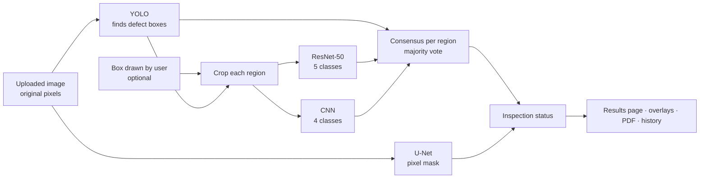

# METALVISION AI — Metal Surface Defect Inspection

METALVISION AI finds and classifies defects in images of steel surfaces. Four deep-learning models work together in one local web application:

- **YOLO** locates defects.
- **ResNet-50** and a **custom CNN** classify every located region.
- **U-Net** marks suspicious pixels across the whole image.

You upload an image, run one inspection, review the flagged regions and download a PDF report.

> B.Tech group project, Department of CSE, IIIT Kalyani. Academic prototype: not a validated industrial inspection system. Every result must be checked by a person.

---

## Contents

1. [What it does](#1-what-it-does)
2. [Results](#2-results)
3. [How the inspection pipeline works](#3-how-the-inspection-pipeline-works)
4. [Dataset](#4-dataset)
5. [The four models](#5-the-four-models)
6. [Repository structure](#6-repository-structure)
7. [Quick start: run the app](#7-quick-start-run-the-app)
8. [Using the app](#8-using-the-app)
9. [Reproducing the data pipeline and training](#9-reproducing-the-data-pipeline-and-training)
10. [Known limitations](#10-known-limitations)
11. [Roadmap](#11-roadmap)
12. [Team](#12-team)
13. [References](#13-references)

---

## 1. What it does

| Step | What happens |
|---|---|
| **Upload** | PNG, JPG or TIFF up to 25 MB. The file is checked (extension, file signature, full decode, size limits) and stored unchanged. |
| **Inspect** | *Full Inspection* runs all four models. You can also run any single model. |
| **Review** | For every region, the results page shows each model's label and confidence and how many models agree. It also shows the box and mask overlays, per-model timing and a human-review field. |
| **Report** | A PDF with the images, overlays, regions table, model status and reviewer note. |
| **History** | Every inspection is stored in SQLite and can be searched and filtered. The dashboard shows statistics. |

The app runs offline on a laptop CPU, with no paid APIs or keys.

## 2. Results

Each team member evaluated their model on a held-out test split they made themselves. **The splits are not identical, so these numbers are not a direct head-to-head comparison** (see the [roadmap](#11-roadmap)).

| Model | Task | Test set | Main results | Source |
|---|---|---|---|---|
| **ResNet-50** | 5-class crop classification | 202 crops from 154 images | **Accuracy 95.5%**, macro-F1 0.861 | `metalvision-ai/ResNet_Handoff/reports/` |
| **CNN** | 4-class crop classification | 208 crops | **Accuracy 89.9%**, macro-F1 0.713 | `results/opencv_comparison.csv` |
| **U-Net** | Defect segmentation | 162 images | **Dice 0.604**, IoU 0.471 (mean per image); pixel accuracy 89.7% | `notebooks/Metal_Defect_UNet_Training_(4) (5).ipynb` |
| **YOLO** | Defect detection | — | Not yet reported (no evaluation run in the repo) | `yolo_part/` |

<details>
<summary>ResNet-50 per-class results (test split)</summary>

| Class | Precision | Recall | F1 | Test crops |
|---|---|---|---|---|
| silk_spot | 0.983 | 0.975 | 0.979 | 118 |
| inclusion | 0.959 | 0.940 | 0.950 | 50 |
| waist_folding | 1.000 | 1.000 | 1.000 | 21 |
| rolled_pit | 0.778 | 1.000 | 0.875 | 7 |
| water_spot | 0.500 | 0.500 | 0.500 | 6 |

The two rare classes have very few test crops, so their scores are unstable.
</details>

<details>
<summary>OpenCV preprocessing study (CNN)</summary>

| Preprocessing at test time | Accuracy | Macro-F1 |
|---|---|---|
| None (original) | 0.899 | 0.713 |
| Gaussian blur 3×3 | 0.841 | 0.587 |
| CLAHE | 0.529 | 0.464 |

The CNN was trained on unprocessed crops, and the filters were applied only at test time. So this shows how sensitive the model is to a change in input, not that CLAHE is a bad filter in general. That is why the app feeds the models the original image.
</details>

**Speed in the app** (one laptop CPU, approximate): YOLO 30–110 ms per image, ResNet-50 about 55 ms per region, CNN about 6 ms per region, U-Net about 120 ms per image. A Full Inspection of a 2048×1000 image takes roughly 0.3–0.5 s.

## 3. How the inspection pipeline works



1. **YOLO** runs on the original image and returns up to 10 boxes, highest confidence first.
2. Each box is cropped and classified by **ResNet-50** and the **CNN**. A box you draw on the upload page is classified as well.
3. Each region gets a **consensus** label by majority vote among the models that saw it, shown as an agreement count such as `3/3`.
4. **U-Net** produces a mask over the whole image.
5. **Status** for the image:
   - **Suspicious** if YOLO found a box with confidence ≥ 0.50.
   - **Requires Manual Review** if only weaker boxes were found, only a hand-drawn region was classified, or only U-Net flagged pixels.
   - **Normal** only if no model flagged anything. The app says this is not proof the part is defect-free.

If a model's file is missing, that model is reported as *not available* and adds nothing; the app never invents output. If no model can run at all, the app switches to a clearly labelled demonstration mode.

The code is in [`metalvision-ai/backend/pipeline.py`](metalvision-ai/backend/pipeline.py).

## 4. Dataset

The images come from **GC10-DET**, a public benchmark of steel-surface defect images from an industrial line-scan camera (Lv et al., 2020). We used a subset plus a small set of extra *deburring* images.

| | Count |
|---|---|
| Images | 1,075 |
| Labelled boxes (Pascal VOC XML) | 1,444 |
| Boxes kept after cleaning and label standardisation | 1,401 |
| Boxes excluded for review (deburring, not a GC10-DET class) | 43 |
| Defect crops for the CNN and ResNet | 1,340 |

**Boxes per class** (after standardisation, by the XML label):

| silk_spot | inclusion | waist_folding | rolled_pit | water_spot | oil_spot | crease | punching_hole | crescent_gap | welding_line |
|---|---|---|---|---|---|---|---|---|---|
| 806 | 331 | 142 | 61 | 40 | 14 | 4 | 1 | 1 | 1 |

Notes:
- **The data is very imbalanced.** silk_spot alone is 58% of the boxes. The classifiers use class-weighted losses and report macro-F1.
- **Folder names and XML labels sometimes disagree.** For example, the `inclusion` folder contains 40 water_spot boxes. The pipeline always trusts the label inside the XML file.
- **Group-aware splitting.** All crops from one original image stay in the same split, which prevents leakage (`src/check_split_leakage.py`).
- **Raw images are not in Git** (`dataset/raw/` is ignored). Get `dataset_for_colab.zip` from the team Google Drive, or download GC10-DET from its authors.

## 5. The four models

| | YOLO | ResNet-50 | CNN | U-Net |
|---|---|---|---|---|
| **Job in the pipeline** | Find defects (boxes) | Classify each region | Classify each region | Mark suspicious pixels |
| **Input** | Original image | RGB crop → 224×224, aspect kept, grey padding, ImageNet normalisation | RGB crop → 128×128, normalised to [-1, 1] | RGB → 256×256 + OpenCV CLAHE, scaled to [0, 1] |
| **Output** | Boxes + label + confidence | 5 class probabilities | 4 class probabilities | Probability map → binary mask (threshold 0.5) |
| **Classes** | 12 raw GC10-DET labels (shown in English) | silk_spot, inclusion, waist_folding, rolled_pit, water_spot | silk_spot, inclusion, waist_folding, rolled_pit | defect / background |
| **Training** | Ultralytics YOLO, 80/20 split by image | ImageNet transfer learning, best epoch 15 by validation macro-F1 | From scratch, Adam, class-weighted cross-entropy, early stopping | BCE + Dice loss, Adam, 50 epochs, masks generated from boxes |
| **Weights file** | `yolo_part/models/balanced_v3_best.pt` | `metalvision-ai/ResNet_Handoff/models/resnet/resnet50_best.pth` (Git LFS) | `models/cnn_four_class.pth` | `metalvision-ai/models/unet/best_unet_opencv_improved.pth` (**not in Git**, see §7) |

Architecture details:
- **CNN:** four Conv→BatchNorm→ReLU blocks (32-64-128-128 channels), global average pooling, dropout 0.3, linear layer. Code in `src/train_cnn.py`.
- **ResNet-50:** residual blocks `y = F(x) + x`. ImageNet weights, with the final layer replaced by a 5-class head.
- **U-Net:** 3-level encoder (16-32-64), 128-channel bottleneck, transposed-convolution decoder with skip connections. 482,033 parameters. Code in `src/unet.py`.

## 6. Repository structure

```
Metal-surface-defect-inspection/
├── metalvision-ai/                 ← the web application (start here)
│   ├── app.py                      Flask routes
│   ├── config.py                   paths, limits, checkpoint locations
│   ├── backend/
│   │   ├── pipeline.py             Full Inspection: YOLO → ResNet + CNN → consensus, U-Net
│   │   ├── yolo_inference.py       YOLO loader + English label mapping
│   │   ├── resnet_inference.py     ResNet-50 loader + crop classifier
│   │   ├── cnn_inference.py        CNN loader + crop classifier
│   │   ├── unet_inference.py       U-Net loader + segmentation
│   │   ├── base_model.py           shared model interface and result format
│   │   ├── model_manager.py        registry of the four models
│   │   ├── preprocessing.py        OpenCV preprocessing views
│   │   ├── visualization.py        box and mask overlays
│   │   ├── validation.py           upload checks
│   │   ├── history.py              SQLite storage
│   │   └── report_generator.py     PDF reports
│   ├── frontend/                   HTML templates, CSS, JavaScript
│   ├── models/{cnn,resnet,unet,yolo}/   optional weights files + metrics.json
│   ├── ResNet_Handoff/             ResNet-50 weights (Git LFS) and evaluation reports
│   ├── tests/                      smoke tests + ResNet evaluation script
│   └── requirements.txt
├── src/                            data pipeline, CNN training, OpenCV study
├── yolo_part/                      YOLO dataset preparation, weights, sample predictions
├── notebooks/                      U-Net training notebook (Google Colab)
├── dataset/processed/              annotation CSVs and crop manifests (raw images not in Git)
├── models/cnn_four_class.pth       trained CNN
└── results/                        CNN confusion matrix, training curves, OpenCV comparison
```

## 7. Quick start: run the app

You need **Git**, **Git LFS** and **Python 3.10 or newer**. These steps were tested on Windows with Python 3.14.

### Step 1: Get the code, including the large ResNet file

```bash
git lfs install                 # once per computer
git clone https://github.com/Mausam012/Metal-surface-defect-inspection.git
cd Metal-surface-defect-inspection
git lfs pull                    # downloads resnet50_best.pth (94 MB)
```

If you already cloned before installing Git LFS, run `git lfs install` and then `git lfs pull`.

### Step 2: Add the U-Net weights

The U-Net file is not in Git. Get `best_unet_opencv_improved.pth` (about 1.9 MB) from a teammate or from the team Google Drive (`My Drive/Metal_Defect_Project/`). Put it in:

```
metalvision-ai/models/unet/best_unet_opencv_improved.pth
```

> **Do not unzip it.** A `.pth` file is internally a zip archive, and Windows sometimes extracts it into a folder when downloading. If you end up with a folder instead of a file, ask for the file again.

The app still runs without it; U-Net then shows as *Not Integrated*.

### Step 3: Install

```bash
cd metalvision-ai
python -m venv .venv
.venv\Scripts\activate                    # macOS / Linux: source .venv/bin/activate
pip install torch torchvision --index-url https://download.pytorch.org/whl/cpu
pip install -r requirements.txt
```

The first `pip` line installs the small CPU-only PyTorch build instead of a 2 GB GPU download. The full install takes 5–10 minutes.

### Step 4: Run

```bash
python app.py
```

Open **http://127.0.0.1:5000**. The **ML Models** page should show all four models as **Integrated**.

### Step 5 (optional): Check the install

```bash
python -m pytest -q tests      # expected: 5 passed (about 1 minute)
```

### Troubleshooting

| Symptom | Cause | Fix |
|---|---|---|
| ResNet shows *Load Error* | Git LFS was not installed, so you have a 1 KB placeholder instead of the weights | `git lfs install` then `git lfs pull` |
| U-Net shows *Not Integrated* | The file is missing from `models/unet/` | Step 2 |
| U-Net shows *Load Error* | The file was unzipped, renamed to a folder, or comes from a different architecture | Get the original file again |
| YOLO shows *Not Integrated* | `ultralytics` is not installed | `pip install -r requirements.txt` |
| `pip` downloads a huge `torch` wheel | It picked the GPU build | Use the `--index-url .../whl/cpu` line first |
| Port 5000 busy | Another program is using it | Edit the last line of `app.py` to another port, e.g. `port=5001` |

## 8. Using the app

| Page | Purpose |
|---|---|
| **Dashboard** | Counts by status, uploads per day, recent inspections, model status |
| **Upload** | Drop an image, pick **Full Inspection** (default) or a single model, optionally draw a box around a defect |
| **Preprocessing** | Compare the original, grayscale, normalised and processed views. These views are for inspection; the models use the original image |
| **Results** | Status, regions table (YOLO / ResNet-50 / CNN / consensus), model pipeline card, overlays with zoom, human review, PDF download |
| **ML Models** | What each model does, whether its file loaded, and its evaluation results |
| **History** | Search, filter and delete past inspections |

Running ResNet or the CNN on its own requires a drawn box, because neither can find defects. Full Inspection lets YOLO find the regions.

## 9. Reproducing the data pipeline and training

The root-level scripts use the same Python environment as the app. Put the raw data in `dataset/raw/images/<class folder>/` and `dataset/raw/label/*.xml`, then run the scripts from the repository root:

| # | Command | Produces |
|---|---|---|
| 1 | `python src/xml_to_csv.py` | `dataset/processed/annotations.csv` |
| 2 | `python src/clean_annotations.py` | `annotations_cleaned.csv` (boxes clipped to the image) |
| 3 | `python src/final_dataset_check.py` | validation report (missing or corrupt files, bad boxes, duplicates) |
| 4 | `python src/standardize_labels.py` | `annotations_training_ready.csv` + `annotations_excluded_for_review.csv` |
| 5 | `python src/data_preprocessing.py` | `dataset/cnn_crops/` + `cnn_crops_manifest.csv` |
| 6 | `python src/train_cnn.py` | `models/cnn_four_class.pth`, `cnn_split_manifest.csv`, plots in `results/` |
| 7 | `python src/check_split_leakage.py` | confirms no original image appears in two splits |
| 8 | `python src/evaluate_opencv.py` | `results/opencv_comparison.csv` |
| 9 | `python src/prepare_data.py` | box-shaped masks in `dataset/masks/` for U-Net |

Other models:
- **U-Net:** run `notebooks/Metal_Defect_UNet_Training_(4) (5).ipynb` in Google Colab with `dataset_for_colab.zip` on Drive.
- **YOLO:** `python yolo_part/prepare_yolo_dataset.py` builds the YOLO-format dataset and `data.yaml`. Edit `DATASET_ROOT` at the top first; it is a personal path. The training command and results are not in the repo yet.
- **ResNet-50:** the trained weights and evaluation reports are in `metalvision-ai/ResNet_Handoff/`. The 5-class training script is not in the repo yet. `metalvision-ai/backend/resnet_training.py` is a generic template that expects a `normal` class, so it was not used for this model.
- **ResNet evaluation in the app:** `python metalvision-ai/tests/test_resnet_local.py` re-runs the 202-crop test (it reproduces about 95% accuracy).

## 10. Known limitations

- **No "normal" class.** GC10-DET images all contain defects, so the classifiers always name a defect type, and *Normal* only means no model flagged anything.
- **U-Net output is box-shaped.** Its training masks were filled bounding boxes, so its masks follow boxes, not exact defect outlines. Its Dice score is measured against those boxes.
- **Class sets differ between models** (YOLO 12 raw labels, ResNet 5, CNN 4). ResNet and the CNN can never confirm a YOLO *deburring* or *oil_spot* box, so agreement on those is low by design.
- **Different test splits** per model (§2). Rare classes have tiny test sets (rolled_pit: 1 CNN test crop; water_spot: 6 ResNet test crops).
- **Uncalibrated confidences.** Softmax and detector scores are not probabilities of being correct.
- **Project framing.** Parts of the app UI and the original proposal describe *X-ray / internal* inspection, but the data is GC10-DET *surface* images. This must be settled before submission (see roadmap).
- **Prototype server.** Flask development server, single user, no login. Not hardened for public hosting.

## 11. Roadmap

### ✅ Phase 1: Completed

- [x] XML → CSV annotation pipeline, cleaning, validation and label standardisation (`src/`)
- [x] Group-aware train/validation/test split with leakage check
- [x] CNN trained and evaluated, plus the OpenCV preprocessing study
- [x] U-Net trained in Colab (Dice 0.604 on the test split)
- [x] YOLO dataset prepared and detector trained (`balanced_v3_best.pt`)
- [x] ResNet-50 transfer-learning model trained and evaluated (95.5% test accuracy)
- [x] Flask web app: upload, validation, preprocessing views, history, dashboard, PDF reports
- [x] **All four models integrated** into one Full Inspection pipeline with per-region consensus
- [x] Automated smoke tests, including loading the real model files

### 🔜 Phase 2: Before the final demo and submission

- [ ] **Decide the project framing** (surface defects on GC10-DET vs. X-ray), then update the app text (About page, dashboard, upload page) and the report to match
- [ ] **Share the U-Net file properly:** commit it through Git LFS (about 2 MB) so teammates don't have to pass it around
- [ ] **Commit the missing training code:** the ResNet-50 5-class training script or notebook, and the YOLO training command or notebook
- [ ] **Evaluate YOLO** on its validation split: mAP@0.5, mAP@0.5:0.95, per-class precision and recall. Add the numbers to `metalvision-ai/models/yolo/metrics.json`
- [ ] **Clean the repo:**
  - remove empty placeholders (`app.py`, `requirements.txt` and `notebooks/01_dataset_exploration.ipynb` at the root; `src/train_resnet.py`, `train_unet.py`, `train_xgboost.py`, `train_yolo.py`)
  - remove the 11 `*.bak` files in `metalvision-ai/`
  - remove the duplicate `models/resnet/README_backup.md`
- [ ] **Remove personal hard-coded paths** (`C:\Users\...`) from `yolo_part/*.py`, `yolo_part/dataset/data.yaml` and `metalvision-ai/scripts/test_resnet_crops.py`
- [ ] **Fill the project report** with the final numbers and screenshots of the app

### 📊 Phase 3: Fair comparison and better models

- [ ] **One shared split for all four models**, built from original images with every class present in each split. Re-evaluate everything with the same metrics so the comparison table is valid
- [ ] **Handle rare classes:** stratified group k-fold cross-validation, or merge or drop classes with fewer than about 20 boxes
- [ ] **Align the class sets:** merge `10_yaozhe` / `10_yaozhed` in the YOLO labels and retrain the CNN with water_spot, so all models share one vocabulary
- [ ] **Add defect-free images** so the system can genuinely answer "no defect", then tune the status thresholds on validation data
- [ ] **Calibrate confidences** (temperature scaling) and show calibrated probabilities
- [ ] **Redo the OpenCV study properly:** train one model per preprocessing method instead of changing only the test images
- [ ] **Better U-Net masks:** pixel-accurate labels (hand-drawn or model-assisted) instead of filled boxes
- [ ] **Weighted consensus:** weight each model's vote by its validation F1 for that class instead of a simple majority

### 🧩 Phase 4: Product features

- [ ] **Grad-CAM heatmap for ResNet-50** on the results page (the code exists in `resnet_inference.py`, it just isn't wired in)
- [ ] **Batch inspection:** upload a folder, get a summary table and a CSV export
- [ ] **Side-by-side model comparison** view for one image
- [ ] **Settings page** for detection threshold, number of regions and status bands
- [ ] **One-command setup:** Docker image or a setup script, and use the GPU when available
- [ ] **Deployment hardening:** production WSGI server (waitress / gunicorn), login, CSRF protection, if the app is ever shared beyond a laptop

### 🔬 Phase 5: Research extensions

- [ ] If the X-ray framing is kept, add a radiography dataset (e.g. GDXray castings and welds) and study the domain gap
- [ ] Lightweight models (e.g. MobileNet, YOLO-nano) and ONNX export for faster or edge inference
- [ ] Active learning: feed reviewer decisions ("Confirmed defect" / "False alarm") back into training

## 12. Team

| Member | Main contribution (from the commit history) |
|---|---|
| Mousami Keshari ([@Mausam012](https://github.com/Mausam012)) | Annotation pipeline, data cleaning and validation, CNN training, OpenCV study |
| [@Koyel123-a](https://github.com/Koyel123-a) | U-Net segmentation model |
| [@Sayan-Mondal-2005](https://github.com/Sayan-Mondal-2005) | YOLO detection module |
| Saurabh Kesharwani | ResNet-50 model, web application frontend and structure |
| Saksham Jaiswal | Final integration |

## 13. References

- X. Lv, F. Duan, J. Jiang, X. Fu, L. Gan, "Deep Metallic Surface Defect Detection: The New Benchmark and Detection Network," *Sensors*, 20(6):1562, 2020. (GC10-DET dataset)
- K. He, X. Zhang, S. Ren, J. Sun, "Deep Residual Learning for Image Recognition," CVPR 2016. (ResNet)
- O. Ronneberger, P. Fischer, T. Brox, "U-Net: Convolutional Networks for Biomedical Image Segmentation," MICCAI 2015.
- J. Redmon, S. Divvala, R. Girshick, A. Farhadi, "You Only Look Once: Unified, Real-Time Object Detection," CVPR 2016; Ultralytics YOLO, https://github.com/ultralytics/ultralytics
- R. R. Selvaraju et al., "Grad-CAM: Visual Explanations from Deep Networks via Gradient-based Localization," ICCV 2017.

No licence file has been added yet. Until one is, all rights are reserved by the authors. GC10-DET images remain subject to their original terms and are not redistributed here.
