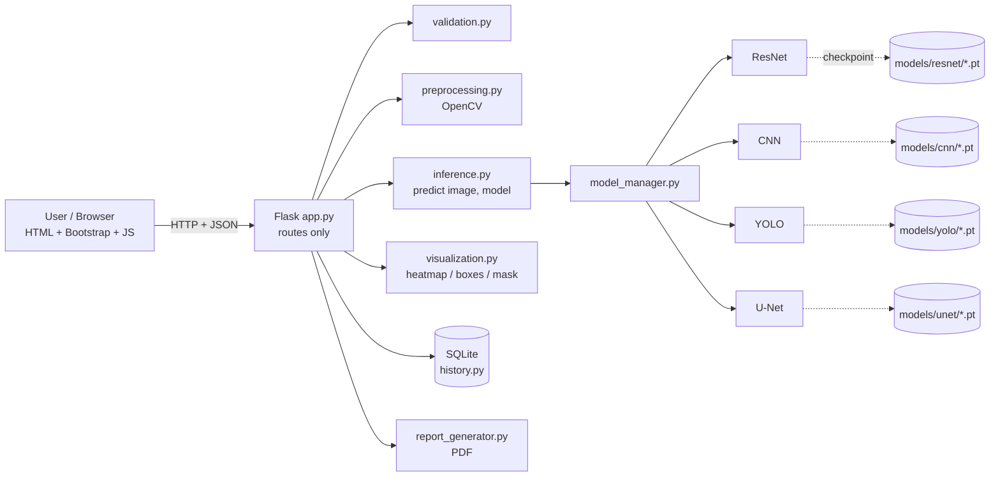
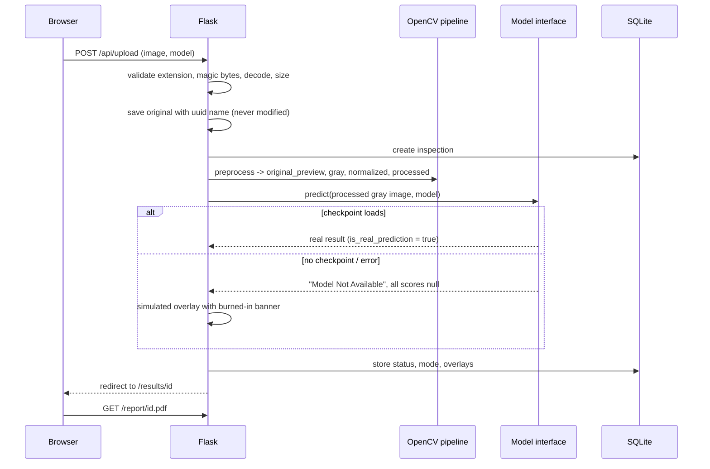

# METALVISION AI
### Intelligent X-Ray Based Metal Inspection System

**Project:** AI-Based Internal Anomaly Detection in Metal Sheets Using X-Ray Images
**Status:** academic prototype. **No ML model is trained or included.** Every result produced before a real checkpoint is installed is labelled as demonstration output.

---

## 1. Introduction

METALVISION AI is a local web application that takes an X-ray radiograph of a metal sheet, prepares it with OpenCV, sends it through one of four interchangeable model slots (CNN, YOLO, U-Net, ResNet), visualizes suspicious regions, stores an inspection history in SQLite and produces a PDF report.

What works today: upload and validation, OpenCV preprocessing, results page, history, model status page, PDF reports, a common inference interface, and a complete ResNet training pipeline.
What does **not** exist yet: trained models, real predictions, any accuracy figure. The app never invents one.

## 2. Problem statement

Cracks, voids, porosity and inclusions inside metal sheets are invisible from outside. Radiography shows them, but reading images by hand is slow and varies between inspectors. The goal is computer-assisted screening that points a human inspector at suspicious regions.

## 3. Objectives

1. Accept radiographs (PNG, JPG, TIFF) and prepare them reproducibly.
2. Detect and localize cracks, voids, porosity and inclusions.
3. Compare four architectures on identical data splits and metrics.
4. Keep real AI output strictly separate from demonstration output.
5. Store inspections and generate reports.

## 4. System architecture



### Data flow



### Layers and who talks to whom

| Layer | Files | Talks to |
|---|---|---|
| Frontend | `frontend/templates`, `frontend/static` | Flask via HTML pages and `/api/*` JSON |
| Routes | `app.py` | `backend/*` only; contains no image or ML logic |
| Image pipeline | `backend/validation.py`, `preprocessing.py`, `visualization.py` | OpenCV, NumPy, Pillow |
| Model interface | `backend/base_model.py`, `inference.py`, `model_manager.py` | the four model modules |
| Models | `backend/{resnet,cnn,yolo,unet}_inference.py` + `models/*/` | PyTorch (imported lazily) |
| Storage | `backend/history.py`, `database/inspection.db` | sqlite3 |
| Reports | `backend/report_generator.py` | ReportLab |

## 5. Technology stack

Frontend: HTML5, CSS3, JavaScript, Bootstrap 5, Chart.js. Backend: Python, Flask. Images: OpenCV, NumPy, Pillow. ML: PyTorch, Torchvision, scikit-learn. Database: SQLite. Plots and PDF: Matplotlib, ReportLab. No paid APIs, no keys.

## 6. Directory structure

```
metalvision-ai/
├── app.py                     Flask routes (create_app factory)
├── config.py                  paths, limits, app name
├── requirements.txt
├── backend/
│   ├── validation.py          upload checks
│   ├── preprocessing.py       OpenCV pipeline
│   ├── visualization.py       overlays (+ simulated demo overlay)
│   ├── base_model.py          BaseModel, result schema, status thresholds
│   ├── torch_utils.py         shared PyTorch helpers
│   ├── model_manager.py       registry of the four models
│   ├── inference.py           predict(image, model_name)
│   ├── resnet_inference.py    ResNet-18/34/50 builder, loader, Grad-CAM
│   ├── resnet_training.py     full training / evaluation CLI
│   ├── cnn_inference.py       CNN slot
│   ├── yolo_inference.py      YOLO slot
│   ├── unet_inference.py      U-Net slot
│   ├── history.py             SQLite
│   └── report_generator.py    PDF
├── frontend/
│   ├── templates/             base, index, upload, preprocess, results, models, history, about, error
│   └── static/{css,js}/       style.css, main.js, upload.js, charts.js, history.js
├── models/{cnn,yolo,unet,resnet}/   put checkpoints here (+ README per folder)
├── dataset/{train,validation,test}/{normal,defective}/   your authorized data
├── data/{sample,annotations}/
├── uploads/  processed/  reports/  database/    created/used at runtime
├── notebooks/dataset_exploration.ipynb
├── scripts/                   make_synthetic_sample.py, download_vendor.py
└── tests/test_smoke.py
```

## 7. Installation

Requires Python 3.10+.

```bash
cd metalvision-ai
python -m venv .venv                 # 8. virtual environment
source .venv/bin/activate            # Windows: .venv\Scripts\activate
pip install -r requirements.txt      # 9. dependencies
```

PyTorch is only needed for ResNet/CNN/U-Net. If it is missing the app still runs in demonstration mode. For a small CPU-only install see https://pytorch.org/get-started/locally/.

Offline demo (no internet in the lab)? Run once while online: `python scripts/download_vendor.py`. Otherwise Bootstrap and Chart.js load from a CDN.

## 8. Run the application

```bash
python app.py            # http://127.0.0.1:5000
python tests/test_smoke.py   # optional: checks the whole demo flow
```

## 9. How to upload an X-ray image

1. Open **Upload**, drop a PNG/JPG/TIFF (max 25 MB) or click *Browse files*.
2. Check name, format, dimensions, size in the preview panel.
3. Choose a model and click **Analyze image**, or **Preprocess only** to inspect the pipeline first.
4. No test image? `python scripts/make_synthetic_sample.py` creates a synthetic one (not an X-ray).

## 10. How preprocessing works

All steps in `backend/preprocessing.py`; each writes a new PNG in `processed/<id>/`.

| Step | Detail |
|---|---|
| Read | `cv2.IMREAD_UNCHANGED` keeps 8/16-bit depth |
| Grayscale | only if the file has colour channels; alpha dropped |
| Normalize | linear stretch (1–99 percentile by default, or min-max) |
| Resize | only if the longest side exceeds 1024 px (area interpolation) |
| CLAHE | **off by default**; local contrast can create or hide defect-like texture |

Settings used are saved with the inspection (`preprocess_settings`), so any result can be reproduced. The uploaded file is never changed.

## 11. Demonstration mode: how the app avoids misleading anyone

- `is_real_prediction` is `true` only when a loaded checkpoint ran. Otherwise status is **Model Not Available** and score, confidence, category and time are `null`.
- Overlays in that case use fixed arbitrary geometry (not derived from the image) and carry a banner burned into the pixels: *SIMULATED VISUALIZATION — NOT AN AI PREDICTION*. The PDF repeats this.
- The dashboard counts real predictions separately. Demo history rows are tagged DEMO and excluded from statistics unless you ask for them.
- The Models page shows metrics only if `models/<name>/metrics.json` exists, written by a real evaluation run.

## 12. Model integration (for the four team members)

All models implement `BaseModel` (`backend/base_model.py`):

```python
def load(self, checkpoint_path): ...   # build network, load weights, set self._model / self.meta
def _predict(self, gray8): ...         # uint8 2-D array -> dict with only what the model really outputs
```

Result schema (`make_result`):

```python
{"model_name", "model_version", "status", "defect_category", "score", "confidence",
 "bounding_boxes": [{"x","y","w","h","label","confidence"}],   # YOLO
 "segmentation_mask": ndarray|None,                            # U-Net, uint8 (H, W)
 "heatmap": ndarray|None,                                      # ResNet Grad-CAM, float [0,1]
 "inference_time_ms", "is_real_prediction", "error", "notes"}
```

The base class handles missing checkpoints, incompatible files, exceptions and timing, so a model owner only writes `load` and `_predict`.
Adding a fifth model = new class + one line in `model_manager._CLASSES`.

**Who owns what**

| Member | Files they edit | Checkpoint |
|---|---|---|
| ResNet | `resnet_inference.py`, `resnet_training.py`, `models/resnet/` | `models/resnet/resnet18_best.pt` |
| CNN | `cnn_inference.py`, `models/cnn/` | `models/cnn/cnn_best.pt` (`arch="simple_cnn"`) |
| YOLO | `yolo_inference.py`, `models/yolo/` | `models/yolo/best.pt` (Ultralytics) |
| U-Net | `unet_inference.py`, `models/unet/` | `models/unet/unet_best.pt` (`arch="unet"`) |

No one needs to touch `app.py` or the frontend to integrate a model.

### 13. CNN
Edit `build_simple_cnn` (or replace it). Save `{"arch": "simple_cnn", "state_dict", "class_names", "in_channels", "img_size", "mean", "std"}` with `torch.save`. Class names must include `normal`.

### 14. YOLO
`pip install ultralytics`, train on box labels (YOLO txt), copy `best.pt` to `models/yolo/`. Boxes are in processed-image pixels. Ultralytics weights are pickle-based: load only files you trust.

### 15. U-Net
Train on binary masks with `build_unet` from `unet_inference.py` (input size divisible by 16, default 256). Save `{"arch": "unet", "state_dict", "base", "in_channels", "img_size"}`. Needs pixel-level annotations.

### 16. ResNet (the architecture in detail)

**Residual block.** A plain deep network gets harder to optimise as layers are added. ResNet wraps a few layers in a skip connection:

```
y = F(x) + x
```

`F(x)` is what the stacked convolutions learn (the residual), `x` is carried over unchanged. If the best behaviour is "do nothing", the block only needs `F(x) = 0`, and gradients flow through the `+ x` path unimpeded. If shapes differ, a 1×1 convolution on the shortcut matches them. See `models/resnet/residual_block_demo.py`.

**Variants.** ResNet-18 and 34 use two-conv basic blocks; ResNet-50 uses 1×1–3×3–1×1 bottleneck blocks. Start with ResNet-18 on a laptop.

**Transfer learning.** Load ImageNet-pretrained weights (generic edge and texture filters), replace the final `fc` layer with one sized for your classes, and fine-tune. Optionally train only `fc` for the first few epochs (`--freeze-epochs`).

**Grayscale X-rays.** Pretrained ResNets expect 3 channels. Default: repeat the gray channel 3× (`--in-channels 3`). Alternative: sum the pretrained `conv1` filters into one channel (`--in-channels 1`). The choice is stored in the checkpoint so inference matches training.

**Inference.** `ResNetModel._predict` returns `score = 1 − p(normal)`, `confidence = max softmax`, a status from the bands in `base_model.py` (below 0.35 Normal, 0.35–0.65 Requires Manual Review, 0.65+ Suspicious; uncalibrated, tune on validation data) and a Grad-CAM heatmap. Grad-CAM shows evidence, not defect outlines.

## 17. ResNet training

```bash
# A) folders:  dataset/{train,validation,test}/{normal,defective}/
python -m backend.resnet_training train --data-dir dataset --arch resnet18 --epochs 20 \
       --dataset-note "describe source, geometry, license"

# B) CSV manifest with group-aware split (recommended)
#    all_images.csv columns: path,label,group      (group = specimen / weld-series ID)
python -m backend.resnet_training make-split --csv all_images.csv --out manifest.csv
python -m backend.resnet_training train --manifest manifest.csv --arch resnet18

# Final, ONE-TIME evaluation on the untouched test split
python -m backend.resnet_training evaluate --checkpoint models/resnet/resnet18_best.pt --manifest manifest.csv
```

Outputs in `models/resnet/`: `resnet18_best.pt`, `training_curves.png`, `confusion_matrix_validation.png` (and `_test.png`), `metrics.json` (precision, recall, F1 per class, macro-F1, confusion matrix, inference ms/image). The web app picks these up automatically.

**Class imbalance.** Inspection data has far more normal than defective images; "always normal" can score high accuracy and be useless. The script (1) reports precision/recall/F1 per class, (2) weights the loss by inverse class frequency, (3) offers oversampling with `--sampler`, and (4) selects the best epoch by validation **macro-F1**, not accuracy.

**Leakage prevention.**
- Split by specimen/component (`group`) before creating crops or augmented copies; `make-split` uses `GroupShuffleSplit`.
- `check_leakage` aborts training if one group appears in two splits.
- Augmentation (flips, ±10° rotation, mild brightness/contrast) is applied to the training split only. Check that flips are valid for your defect type (e.g. oriented weld flaws).
- Validation is used for model selection; test is evaluated once at the end.
- Never randomly split overlapping patches of one image across sets.

## 18. Dataset requirements and documentation

Per dataset, record: source, material, geometry, acquisition setup, annotation type, annotator, license.

**GDXray** (https://github.com/computervision-xray-testing/GDXray) is a public X-ray database for non-destructive testing (Mery et al., *Journal of Nondestructive Evaluation*, 2015). It has groups such as castings and welds; annotation type differs per group (check each group's own documentation). Confirm its current license and citation requirements on the repository before use. As we understand it, it is intended for research and education, so do **not** redistribute its images; this project does not include any.

Limitations that must appear in your report:
- Casting radiographs show complex 3-D parts; welding radiographs show weld seams. Neither is a flat sheet, so their defect appearance, background and thickness differ.
- Do not claim sheet-specific accuracy from casting or weld data. Results on them describe those datasets only.
- Keep original files unmodified; preprocessing writes copies.

**Placeholder for the real target:** authorized flat-metal-sheet X-rays with expert-reviewed annotations go in `data/annotations/` (see its README).

## 19. Evaluation methodology

- Metrics: precision, recall, F1 per class, macro-F1, confusion matrix, inference time. Report recall of defective images prominently (missed defects cost more than false alarms).
- Same splits and metrics for all four models; only compare numbers produced this way.
- Choose thresholds on validation data, report test results once.
- Report class counts for every split and the dataset's domain gap to flat sheets.

## 20. Current limitations

- No trained model; all inference is unavailable until checkpoints exist.
- Only ResNet has a training pipeline; CNN, YOLO and U-Net slots need their owners' training code (loaders are ready).
- Probabilities are uncalibrated; status bands are placeholders.
- Single-user local app: no login, no CSRF protection, Flask development server.
- TIFF files are converted to PNG for display; very large images are downscaled to 1024 px for inference.
- The PyTorch code (ResNet, CNN, U-Net, YOLO loaders and the training script) was written but not executed, because PyTorch and a dataset were not available when it was generated. Automated tests cover the web app, preprocessing, history, reports and the real-versus-demo logic (using a fake model). Expect to debug the training script on your first real run.

## 21. Future scope

Authorized flat-sheet dataset and expert labels; patch-based inference for large radiographs; calibration; side-by-side multi-model comparison on one image; DICOM support; user accounts; production server.

---

## API reference

| Method | Path | Purpose |
|---|---|---|
| POST | `/api/upload` | multipart `image` (+ optional `analyze_with`). Returns `{id, redirect}` |
| POST | `/api/preprocess/<id>` | JSON settings (`normalization`, `low_percentile`, `high_percentile`, `max_side`, `clahe`) |
| POST | `/api/analyze/<id>` | JSON `{"model": "ResNet"}` |
| GET | `/api/inspections?q=&status=` | list / search / filter |
| GET | `/api/inspections/<id>` | details (no server paths) |
| POST | `/api/inspections/<id>/review` | `{"review_status", "note"}` |
| DELETE | `/api/inspections/<id>` | delete record and files |
| GET | `/api/models` | status, hints, real metrics |
| GET | `/api/stats?demo=0|1` | dashboard numbers |
| POST/DELETE | `/api/history/seed-demo` / `/api/history/demo` | add / remove DEMO rows |
| GET | `/files/<id>/<name>` | only whitelisted generated images |
| GET | `/report/<id>.pdf` | PDF report |

Errors are JSON: `{"error": "message"}` with 400 / 404 / 413 / 422 / 500.

## Security notes

Extension allow-list, magic-byte check, full decode, 25 MB and 50-megapixel limits, uuid server filenames, whitelisted file serving (no path traversal), no uploaded content executed, internal paths never returned, `torch.load(weights_only=True)` for checkpoints. Not hardened for public hosting.

## Team workflow

1. Everyone: `pip install -r requirements.txt`, `python app.py`, run `tests/test_smoke.py` before pushing.
2. Each member works only in their own `*_inference.py` + `models/<name>/` folder.
3. Done = checkpoint loads (card turns *Integrated*), a real result shows on the results page, and `metrics.json` comes from `evaluate` on a clean test split.
4. Never commit datasets or checkpoints (`.gitignore` covers them).
