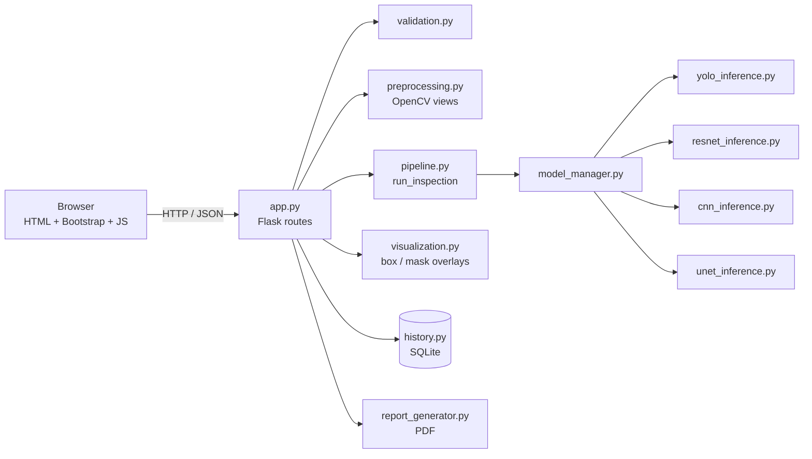
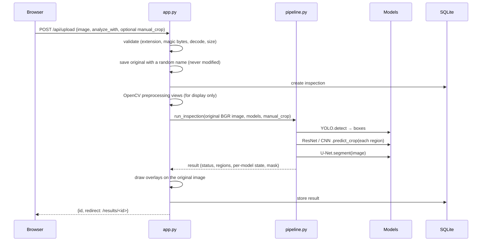

# METALVISION AI — Application Developer Guide

This folder holds the web application. For setup, results, the dataset and the roadmap, see the **[main README](../README.md)**. This page explains how the app is built, so you can change it or add a model.

```bash
# from this folder, after following the main README's Quick start
.venv\Scripts\activate
python app.py                  # http://127.0.0.1:5000
python -m pytest -q tests      # 5 tests, about 1 minute
```

---

## 1. Architecture



| Layer | Files | Responsibility |
|---|---|---|
| Frontend | `frontend/templates/*.html`, `frontend/static/{css,js}` | Pages; `upload.js` handles drag-and-drop and region drawing |
| Routes | `app.py` | HTTP and JSON API only; no image or ML logic |
| Pipeline | `backend/pipeline.py` | Runs the selected models, combines their output, decides the status |
| Models | `backend/*_inference.py`, `base_model.py`, `model_manager.py`, `torch_utils.py` | Load weights files, run inference |
| Images | `validation.py`, `preprocessing.py`, `visualization.py` | Upload checks, OpenCV views, overlays |
| Storage | `history.py` → `database/inspection.db` | One row per inspection |
| Reports | `report_generator.py` | PDF via ReportLab |
| Config | `config.py` | Paths, upload limits, weights-file locations |

### Request flow for an inspection



The models receive the **original upload**, because that is what they were trained on. The OpenCV preprocessing page (percentile normalisation, optional CLAHE) is a viewing tool; U-Net applies its own CLAHE step internally, exactly as in its training notebook.

## 2. The pipeline (`backend/pipeline.py`)

`run_inspection(manager, bgr, models, manual_crop=None)`

| Stage | Model | Detail |
|---|---|---|
| Find regions | YOLO | Confidence ≥ 0.25, sorted by confidence, at most `MAX_REGIONS = 10` kept |
| Manual region | none | If the user drew a box, it is inserted as region #1 (`source = "Manual selection"`) |
| Classify | ResNet-50, CNN | `predict_crop()` on every region |
| Consensus | none | Majority vote of the YOLO / ResNet / CNN labels for that region; `agreement` like `"2/3"`; a tie goes to the first vote (YOLO) |
| Segment | U-Net | `segment()` on the whole image; `mask_coverage` = fraction of pixels |

**Status rules:**

| Condition | Status |
|---|---|
| Best YOLO box has confidence ≥ `STRONG_CONF` (0.50) | Suspicious |
| YOLO boxes exist but all are below 0.50 | Requires Manual Review |
| No YOLO boxes, but a manual region was classified | Requires Manual Review (classifiers have no "normal" class) |
| Only U-Net flagged pixels (≥ 0.05% of the image) | Suspicious if YOLO was not run, otherwise Requires Manual Review |
| Nothing flagged | Normal (with a note that this is not proof) |
| No selected model could run | Model Not Available → demonstration mode |

Every selected model gets a state in `result["models"]`: `ran`, `unavailable` (no file or missing library), `skipped` (e.g. a classifier with no region to classify) or `failed` (an exception, with its type). A model that did not run never contributes output.

**Model choices:** `"Full Inspection"` runs all four. A single name (`"YOLO"`, `"ResNet"`, `"CNN"`, `"U-Net"`) runs only that model. ResNet or CNN alone require `manual_crop`; the upload API rejects the request otherwise.

## 3. Result format

`make_result()` in `backend/base_model.py`, extended by the pipeline:

```python
{
  "model_name": "Full Inspection",          # or the single model's name
  "model_version": "YOLO: yolo / balanced_v3_best.pt, ResNet: resnet50 / resnet50_best.pth, ...",
  "status": "Suspicious",                    # see the status rules above
  "defect_category": "silk_spot",            # consensus label of the best region
  "score": 0.63,                             # best YOLO confidence (or U-Net max probability)
  "confidence": 0.63,
  "bounding_boxes": [{"x", "y", "w", "h", "label", "confidence", "manual"}],
  "segmentation_mask": ndarray | None,       # uint8 (H, W); not stored in the database
  "heatmap": None,
  "inference_time_ms": 301.7,                # sum over the models that ran
  "is_real_prediction": True,                # False only in demonstration mode
  "error": None,
  "notes": ["..."],
  "regions": [{
      "id": 1, "source": "YOLO", "x": 1010, "y": 120, "w": 380, "h": 730,
      "yolo":   {"label": "silk_spot", "confidence": 0.63},
      "resnet": {"label": "silk_spot", "confidence": 0.90, "probabilities": {...}},
      "cnn":    {"label": "silk_spot", "confidence": 0.70, "probabilities": {...}},
      "consensus": "silk_spot", "agreement": "3/3"
  }],
  "models": {"YOLO": {"state": "ran", "time_ms": 30.1, "message": "3 region(s) detected."}, ...},
  "mask_coverage": 0.2277
}
```

All coordinates are in **original-image pixels**. Arrays are removed before the result is saved as JSON (`sanitize_result` in `app.py`).

## 4. Models and weights files

### Where the app looks

Each model looks in `models/<name>/` first and loads the newest `.pt` / `.pth` file there. If that folder is empty, it uses the fallback path from `config.CHECKPOINT_FALLBACKS`:

| Model | `models/` folder | Fallback (already in the repo) |
|---|---|---|
| CNN | `models/cnn/` | `../models/cnn_four_class.pth` |
| ResNet | `models/resnet/` | `ResNet_Handoff/models/resnet/resnet50_best.pth` (Git LFS) |
| YOLO | `models/yolo/` | `../yolo_part/models/balanced_v3_best.pt` |
| U-Net | `models/unet/` | none: put `best_unet_opencv_improved.pth` here |

A file is reloaded automatically when it changes (path + modification time). `*.pt` / `*.pth` files inside `models/*/` are ignored by Git.

### File formats each loader accepts

| Model | Format | Checks |
|---|---|---|
| CNN | `{"model_state_dict", "class_names", "image_size", "best_epoch"}` from `src/train_cnn.py` | Class order must be `silk_spot, inclusion, waist_folding, rolled_pit`; image size 128 |
| ResNet | `{"arch", "class_names", "model_state_dict", "img_size", "mean", "std", ...}` | `arch` in resnet18/34/50; 5 classes in the documented order; strict weight load |
| YOLO | Ultralytics `.pt` | Raw GC10-DET labels are mapped to English (`yolo_inference.GC10_NAMES`) |
| U-Net | (a) the team notebook's raw `state_dict` (architecture of `src/unet.py`), or (b) `{"arch": "unet", "state_dict", "base", "in_channels", "img_size"}` | Detected by its keys; strict weight load |

Every loader uses `torch.load(..., weights_only=True)`. The exception is YOLO: Ultralytics weights are pickle-based, so only load YOLO files you trust.

### Preprocessing each model applies (it must match training)

| Model | Steps |
|---|---|
| CNN | BGR → RGB (PIL) → `Resize((128, 128))` → `ToTensor` → `Normalize(0.5, 0.5)` |
| ResNet | BGR → RGB → shrink to fit 224 keeping the aspect ratio (crops smaller than 224 are not enlarged) → centre on a grey (128) canvas → ImageNet normalisation |
| YOLO | Original BGR image; Ultralytics handles resizing |
| U-Net | BGR → RGB → `cv2.resize(256, 256)` → CLAHE (clip 2.0, 8×8 tiles) on the LAB L channel → `/255` → sigmoid → threshold 0.5 → resized back |

The ResNet resize rule was checked against the 202 test crops: no enlarging gives 95.0% accuracy, enlarging small crops gives 88.1%.

## 5. Adding or replacing a model

1. Create `backend/<name>_inference.py` with a class that inherits `BaseModel`. Set `name`, `dir_name` and the descriptive fields shown on the Models page.
2. Implement `load(self, checkpoint_path)`. Build the network, load the weights, set `self._model` and `self.meta`. Raise `ModelNotAvailable("reason")` for anything the user can fix.
3. Implement the method the pipeline calls for that role:
   - detector: `detect(bgr) -> [{"x","y","w","h","label","raw_label","confidence"}]`
   - region classifier: `predict_crop(bgr_crop) -> {"predicted_class","confidence","class_probabilities"}`
   - segmenter: `segment(bgr) -> (probability_map, binary_mask)`
4. Add the class to `_CLASSES` in `backend/model_manager.py` (and to `_ALIASES` if needed).
5. Add it to `ALL_MODELS` / `CLASSIFIERS` in `backend/pipeline.py`, plus an optional fallback path in `config.py`.
6. Optionally add `models/<dir>/metrics.json` to show evaluation results on the Models page:

```json
{
  "source": "where these numbers come from",
  "evaluated_on": "test", "n_images": 202, "unit": "defect crops",
  "summary": {"Accuracy": 0.955, "Macro-F1": 0.861},
  "macro_f1": 0.861,
  "per_class": {"silk_spot": {"precision": 0.98, "recall": 0.97, "f1-score": 0.98, "support": 118}},
  "inference_ms_per_image": 58.0,
  "caveat": "optional note shown under the numbers"
}
```

Only `summary` or `per_class` is needed. Never put numbers here that a real evaluation did not produce.

## 6. HTTP API

| Method | Path | Purpose |
|---|---|---|
| POST | `/api/upload` | multipart: `image`, optional `analyze_with` (model choice) and `manual_crop` (JSON `{"x","y","width","height"}` in image pixels). Returns `{id, redirect}` |
| POST | `/api/analyze/<id>` | JSON `{"model": "Full Inspection"}`; reuses the saved manual region |
| POST | `/api/preprocess/<id>` | JSON settings: `normalization`, `low_percentile`, `high_percentile`, `max_side`, `clahe`, `clahe_clip` |
| GET | `/api/inspections?q=&status=` | List / search / filter |
| GET | `/api/inspections/<id>` | Full record (server file names removed) |
| POST | `/api/inspections/<id>/review` | `{"review_status", "note"}` |
| DELETE | `/api/inspections/<id>` | Delete the record and its files |
| GET | `/api/models` | Status and metrics of every model |
| GET | `/api/stats?demo=0\|1` | Dashboard numbers |
| POST / DELETE | `/api/history/seed-demo`, `/api/history/demo` | Add / remove labelled DEMO rows |
| GET | `/files/<id>/<name>` | Generated images only (allow-list) |
| GET | `/report/<id>.pdf` | PDF report |

Errors are JSON `{"error": "message"}` with status 400, 404, 413, 422 or 500.

## 7. Configuration (`config.py`)

| Setting | Default | Meaning |
|---|---|---|
| `MAX_CONTENT_LENGTH` | 25 MB | Upload size limit |
| `ALLOWED_EXTENSIONS` | png, jpg, jpeg, tif, tiff | Accepted formats |
| `MAX_PIXELS` | 50 million | Protection against decompression bombs |
| `UPLOAD_DIR`, `PROCESSED_DIR`, `REPORT_DIR` | `uploads/`, `processed/`, `reports/` | Runtime files (ignored by Git) |
| `DB_PATH` | `database/inspection.db` | SQLite database (ignored by Git) |
| `CHECKPOINT_FALLBACKS` | see §4 | Weights files elsewhere in the repo |
| `SECRET_KEY` | env `METALVISION_SECRET_KEY` | Flask session key |

Pipeline tuning constants live at the top of `backend/pipeline.py` (`MAX_REGIONS`, `STRONG_CONF`, `MIN_MASK_FRACTION`) and `backend/yolo_inference.py` (`CONF_THRESHOLD`).

## 8. Tests

| File | What it checks |
|---|---|
| `tests/test_smoke.py::test_full_flow` | All pages load; upload validation; demonstration mode when no models exist; preprocessing; review; PDF; search; delete; path-traversal protection |
| `test_validation` | Bad files are rejected (wrong type, empty, corrupt, mismatched extension) |
| `test_demo_records` | DEMO rows are excluded from statistics by default |
| `test_real_prediction_path` | Pipeline wiring with fake models: regions → classifiers → consensus, stored as real output; re-running a single model reuses the manual region |
| `test_real_checkpoints` | Loads every real weights file found and runs one prediction (skipped if none are present) |
| `tests/test_resnet_local.py` | Script: re-evaluates ResNet-50 on the 202 test crops in `resnet_local_test/` |

## 9. Security notes

- **Upload checks:** extension allow-list, magic-byte check, full decode, size and pixel limits. Random server file names. The original upload is never modified.
- **File serving and API:** files are served only from an allow-list of generated names, so path traversal isn't possible. Internal paths are never returned by the API.
- **Weights files:** `weights_only=True` for every PyTorch file except Ultralytics YOLO weights (pickle-based, so load only trusted files).
- **Deployment:** this is a local, single-user prototype: Flask development server, no login, no CSRF protection. Do not expose it to the internet as is.

## 10. Folder contents

| Path | Contents |
|---|---|
| `ResNet_Handoff/` | ResNet-50 weights (Git LFS), a standalone copy of its inference code, and the evaluation reports |
| `resnet_local_test/` | The 202 ResNet test crops and `test.csv` |
| `models/<name>/` | Optional weights files, `metrics.json`, model notes |
| `scripts/` | `download_vendor.py` (Bootstrap and Chart.js for offline use), `make_synthetic_sample.py`, `test_resnet_crops.py` |
| `notebooks/dataset_exploration.ipynb` | Dataset exploration starter |
| `uploads/`, `processed/`, `reports/`, `database/` | Created at runtime, ignored by Git |
